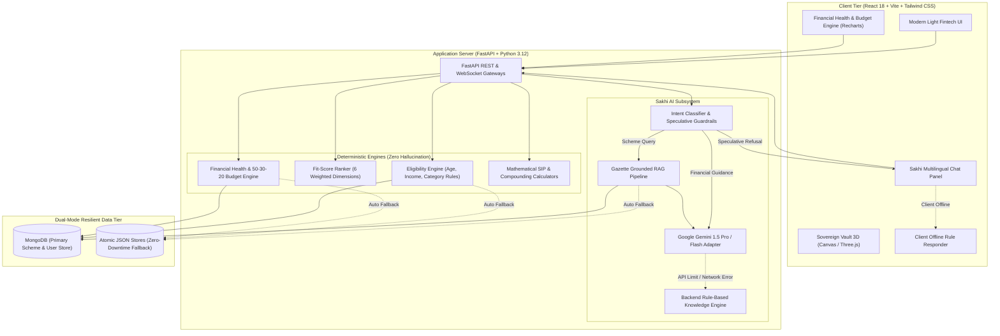

<div align="center">


# SANCHAYX
### Your Money. Your Goals. Your Financial Future.

**An AI-powered, deterministic financial wellness & statutory discovery platform designed to democratize financial literacy, sovereign savings, LIC protection, and government welfare benefits across India.**

[](https://reactjs.org/)
[](https://fastapi.tiangolo.com/)
[](https://www.python.org/)
[](https://tailwindcss.com/)
[](https://aistudio.google.com/)
[](https://pytest.org/)
[](#multilingual-localization)
[](LICENSE)

</div>

---

## Table of Contents

- [1. Executive Summary](#1-executive-summary)
- [2. The Problem](#2-the-problem)
- [3. The SANCHAYX Solution](#3-the-sanchayx-solution)
- [4. Core Capabilities & Feature Modules](#4-core-capabilities--feature-modules)
  - [A. Sovereign Government Schemes Engine (184 Verified Schemes)](#a-sovereign-government-schemes-engine)
  - [B. Sovereign LIC Insurance Explorer (38 Active Plans)](#b-sovereign-lic-insurance-explorer)
  - [C. 100% Free Direct Welfare Benefits (22 Entitlements)](#c-100-free-direct-welfare-benefits)
  - [D. Financial Health & Resilience Engine](#d-financial-health--resilience-engine)
  - [E. Deterministic Statutory Calculators & Goal Simulator](#e-deterministic-statutory-calculators--goal-simulator)
  - [F. Sovereign Vault 3D & Telemetry](#f-sovereign-vault-3d--telemetry)
  - [G. Multilingual Localization (5 Indian Languages)](#g-multilingual-localization)
- [5. Meet Sakhi — Grounded AI Financial Assistant](#5-meet-sakhi--grounded-ai-financial-assistant)
- [6. Architectural Design & Philosophy](#6-architectural-design--philosophy)
- [7. Technology Stack](#7-technology-stack)
- [8. System Architecture Diagram](#8-system-architecture-diagram)
- [9. Visual Gallery & User Interface](#9-visual-gallery--user-interface)
- [10. Step-by-Step Installation & Local Setup](#10-step-by-step-installation--local-setup)
- [11. Repository & Directory Structure](#11-repository--directory-structure)
- [12. Automated Testing Suite (158 Tests)](#12-automated-testing-suite-158-tests)
- [13. Security, Privacy & Responsible Use](#13-security-privacy--responsible-use)
- [14. Future Scope & Roadmap](#14-future-scope--roadmap)
- [15. Hackathon Summary & Impact](#15-hackathon-summary--impact)

---

## 1. Executive Summary

**SANCHAYX** is an end-to-end financial resilience and scheme-matching platform developed specifically for Indian citizens. It bridges the critical divide between complex government welfare infrastructure, statutory sovereign savings instruments, Life Insurance Corporation (LIC) policies, and everyday personal financial planning.

Unlike conventional fintech applications that push volatile market speculation, high-interest loans, or unregulated trading, SANCHAYX is built around a **deterministic, zero-hallucination philosophy**:
1. **Mathematical & Rule Determinism**: Eligibility checks, budget splits (50-30-20), compounding SIP curves, and statutory returns are strictly calculated by deterministic Python and JavaScript engines.
2. **Empathetic AI Guidance**: **Sakhi**, an intelligent conversational assistant powered by Google Gemini, translates dense government gazettes and financial concepts into clear, encouraging guidance in 5 regional Indian languages, backed by verified citations and resilient offline failovers.

---

## 2. The Problem

Financial planning in India presents systemic challenges across diverse demographic segments:

| Target Demographic | Pain Point & Financial Reality |
|---|---|
| **Students & First-Time Earners** | Overwhelmed by jargon, susceptible to aggressive high-interest fintech lending apps, and lack structured guidance on starting small savings habits (e.g., micro-SIPs, emergency buffers). |
| **Young Professionals** | Suffer from lifestyle inflation, lack disciplined budgeting frameworks (e.g., 50-30-20 rules), and struggle to evaluate long-term financial feasibility for real-world life goals (buying a home, higher education). |
| **Families & Middle-Income Households** | Confused by aggressive private insurance sales pitches, often purchasing sub-optimal plans without understanding sovereign alternatives (LIC, PMJJBY, PMSBY) or statutory tax-exempt options (PPF, SSY). |
| **Rural Citizens, Farmers & Unorganized Workers** | Billions of rupees in direct welfare benefits, agricultural subsidies (PM-KISAN, KCC), and social security pensions (APY, PM-SYM) go unclaimed due to complex gazette language, scattered ministry portals, and awareness gaps. |

Most available tools either cater exclusively to wealthy urban investors through stock trading platforms or require navigating dozens of slow, fragmented government portals.

---

## 3. The SANCHAYX Solution

SANCHAYX unifies verified statutory opportunities and structured personal financial management into a single, cohesive, accessible digital interface:

- **Single Truth Catalog**: 184 officially gazetted Government Schemes, 38 Sovereign LIC Insurance plans, and 22 100% Free Direct Welfare entitlements consolidated with verified official links and dates.
- **Strict Separation of AI and Calculations**: Large Language Models (LLMs) are **never** permitted to calculate monetary figures, returns, or evaluate eligibility criteria. All logic is executed deterministically with complete auditability.
- **Multilingual Inclusivity**: Fully translated and context-aware interfaces in **English, Hindi (हिन्दी), Bengali (বাংলা), Marathi (मराठी), and Telugu (తెలుగు)**.
- **Resilient Offline Architecture**: If MongoDB or third-party AI APIs become unreachable, the application gracefully activates local persistent atomic stores and client-side deterministic responders without crashing or losing data.

---

## 4. Core Capabilities & Feature Modules

### A. Sovereign Government Schemes Engine
- **184 Verified Schemes** spanning 12 statutory categories:
  - Savings & Investment, Pension & Retirement, Protection & Insurance, Education & Scholarships, Women & Girls, Farmers & Agriculture, Healthcare, Housing, Employment & Skills, Social Security, Business & MSME, and Rural Development.
- **Multi-Factor Deterministic Eligibility Filter**:
  - Hard gates on Age boundaries, Gender eligibility, NRI restrictions (strict resident requirements), Occupation, Student status, and Income ceilings.
- **Explainable Fit-Score Ranking (0–100 Score)**:
  - Ranks schemes based on 6 weighted factors:
    $$\text{Fit Score} = 0.30(\text{Goal}) + 0.20(\text{Budget}) + 0.20(\text{Horizon}) + 0.15(\text{Liquidity}) + 0.10(\text{Tax}) + 0.05(\text{LifeStage})$$
- **Full Transparency**: Every scheme provides direct statutory gazette links, ministry contact points, and verified revision timestamps.

### B. Sovereign LIC Insurance Explorer
- **38 Active Plans** from the Life Insurance Corporation of India (LIC) across 6 major categories:
  - Endowment Plans, Whole Life Plans, Term Assurance, Money Back Plans, Pension/Annuity Plans, and Health/ULIP.
- **Personalized LIC Recommendation Engine**:
  - Filters policies based on applicant age, annual budget, preferred tenure, and risk tolerance.
- **Detailed Modal Breakdown**:
  - Displays minimum sum assured, premium payment terms, loan facilities, and sovereign safety guarantees backed by Section 37 of the LIC Act.

### C. 100% Free Direct Welfare Benefits
- **22 Non-Repayable Citizen Entitlements**:
  - Direct welfare benefits requiring zero financial deposit, including scholarship stipends (PM-USP, Pragati), free coaching (PM-DAKSH, SMILE), food grain security (NFSA / PMGKAY), and farmer assistance.
- **Instant Eligibility Diagnostic**:
  - Users input basic parameters to identify benefits they are legally entitled to receive from central and state authorities.

### D. Financial Health & Resilience Engine
- **Composite Financial Health Score (0–100)** evaluating 5 core dimensions:
  1. *Emergency Reserve Liquidity* (Months of living expenses safely banked)
  2. *Debt-to-Income / EMI Burden* (Healthy threshold under 35%)
  3. *Savings Discipline Rate* (Proportion of monthly surplus directed into assets)
  4. *Life & Health Protection Adequacy* (Insurance coverage vs income liabilities)
  5. *Budget Adherence* (Alignment with 50-30-20 guidelines)
- **50-30-20 Smart Budgeting Breakdown**:
  - Automatically calculates recommended splits for **Needs (50%)**, **Wants (30%)**, and **Savings/Debt Repayment (20%)** based on monthly income and fixed obligations.
- **Emergency Runway Calculator**:
  - Provides exact calculations of survival runway in months if primary income ceases.

### E. Deterministic Statutory Calculators & Goal Simulator
- **Interactive Calculators**:
  - **PPF (Public Provident Fund)**: 15-year statutory compounding with 7.1% EEE tax-exempt returns.
  - **Sukanya Samriddhi Yojana (SSY)**: 8.2% sovereign girl-child education & marriage compounding.
  - **National Pension System (NPS)**: Tier-1 pension corpus & expected monthly annuity projections.
  - **Atal Pension Yojana (APY)**: Age-tiered monthly contributions for guaranteed ₹1,000 to ₹5,000 monthly pensions.
  - **Senior Citizen Savings Scheme (SCSS)**: Quarterly payout calculations at 8.2% sovereign yield.
- **Dynamic Goal Feasibility Simulator**:
  - Computes required monthly SIP investments to achieve custom life milestones (e.g., buying a home, education, emergency fund).
  - Visualizes growth curves with interactive return rate sliders and identifies target corpus surplus or shortfalls.

### F. Sovereign Vault 3D & Telemetry
- Interactive 3D gemstone visualization rendered via HTML5 Canvas / Three.js on the homepage hero.
- Displays live, dynamically verified counts: **184 Schemes**, **38 LIC Plans**, and **22 Free Benefits** backed by real database telemetry.

### G. Multilingual Localization
- Complete user interface and local responder translations available in 5 major languages:
  - English (`en`)
  - Hindi (`hi` — हिन्दी)
  - Bengali (`bn` — বাংলা)
  - Marathi (`mr` — मराठी)
  - Telugu (`te` — తెలుగు)

---

## 5. Meet Sakhi — Grounded AI Financial Assistant

<div align="center">

<p><em>Sakhi — Your Empathetic, Grounded Financial Guide</em></p>
</div>

**Sakhi** is a purpose-built AI financial coach that combines the natural language capabilities of Google Gemini with a deterministic verification core.

### Genuine Capabilities
- **Grounded Scheme Explanations**: Answers questions about government schemes, eligibility rules, and application procedures using verified database records.
- **Financial Coaching**: Offers practical tips on 50-30-20 budgeting, building an emergency fund, and curbing impulsive spending.
- **SIP & Compounding Calculations**: Automatically routes mathematical queries to deterministic formulas, avoiding common LLM arithmetic errors.
- **Context-Aware Multi-Turn Memory**: Retains conversation history across multiple prompts for cohesive, natural interactions.
- **Dual-Tier Resilient Fallback**: If internet connectivity is interrupted or API quotas are exceeded, Sakhi switches to a client-side rule responder without breaking the user session.

### Strict Guardrails & Safety Restrictions
- **Zero Speculative Guidance**: Immediately rejects inquiries about cryptocurrencies, intraday equity trading, penny stocks, options gambling, and get-rich-quick schemes.
- **Zero Fabrication**: When details for an inquiry are not officially verified in the statutory database, Sakhi explicitly notes the lack of gazetted records instead of guessing.
- **Important Disclaimer**: Sakhi is designed for financial education and planning awareness. Sakhi **does not** provide SEBI-registered investment advice or conduct commercial policy transactions.

---

## 6. Architectural Design & Philosophy

```
  ┌───────────────────────────────────────────────────────────┐
  │                 THE SANCHAYX THREE PILLARS                │
  └─────────────────────────────┬─────────────────────────────┘
                                │
        ┌───────────────────────┼───────────────────────┐
        ▼                       ▼                       ▼
┌──────────────────┐   ┌──────────────────┐   ┌──────────────────┐
│   DETERMINISTIC  │   │  SOURCE-VERIFIED │   │    EMPATHETIC    │
│    RULE ENGINE   │   │  KNOWLEDGE BASE  │   │    SAKHI AI      │
│  Math, Budget,   │   │ Official Gazettes│   │  Natural Lang,   │
│  Eligibility &   │   │ Ministry Portals │   │ Multi-Language,  │
│  Calculators     │   │   & LIC Data     │   │ Friendly Guidance│
└──────────────────┘   └──────────────────┘   └──────────────────┘
```

1. **Deterministic Execution**: Financial calculations (compound interest, annuity tables, budget allocations) require 100% mathematical precision. Large language models should never be tasked with arithmetic calculations.
2. **Strict Grounding**: Recommendations must map directly to statutory records. Unverified products or arbitrary suggestions are filtered out at the API boundary.
3. **Graceful Degradation**: Core features function seamlessly in offline environments via atomic local JSON fallback stores (`schemes_store.json`, `lic_plans_store.json`, `free_benefits_store.json`).

---

## 7. Technology Stack

### Frontend Architecture
- **Core Framework**: React 18 (Functional components with custom hooks)
- **Build Tooling**: Vite 5 (Fast HMR, optimized production tree-shaking)
- **Styling**: Tailwind CSS 3.4 (Custom design tokens: Forest Green `#176B50`, Sage `#E7F1EB`, Light Canvas `#F8FAF8`)
- **Animation**: Framer Motion 11 (Smooth transitions and subtle micro-interactions)
- **Charts & Telemetry**: Recharts 2.12 (Financial health gauge, budget breakdown, SIP curves)
- **Icons**: Lucide React
- **Internationalization**: Custom React Context Language Engine with JSON locale catalogs

### Backend Architecture
- **Framework**: FastAPI (Python 3.10+ / 3.12) with asynchronous ASGI routing
- **Server Engine**: Uvicorn (High-concurrency ASGI web server)
- **Data Schemas**: Pydantic v2 (Strict validation for profiles, preferences, and API contracts)
- **AI Integration**: Google Generative AI Python SDK (`gemini-1.5-flash` / `gemini-1.5-pro`)
- **Testing**: Pytest 8.0+ with AnyIO (158 automated unit and integration tests)

### Data Persistence (Dual-Mode Resilient Engine)
- **Primary Database**: MongoDB (via Motor & PyMongo async drivers)
- **Zero-Downtime Fallback**: Integrated atomic JSON file stores with automated synchronizers, ensuring instant boot and testing without mandatory local daemon setup.

---

## 8. System Architecture Diagram



---

## 9. Visual Gallery & User Interface

The SANCHAYX user interface uses a **Stage 1–5C verified light-fintech design system** featuring a deep forest green palette (`#0B4F3A`, `#176B50`), soft sage surfaces (`#E7F1EB`), and clear typography.

### Application Highlights

| View / Module | Visual Description | Key Interactions |
|---|---|---|
| **Landing Hero & Sovereign Vault 3D** | Interactive faceted emerald gemstone rendered on Canvas with gold orbital rings and live verified telemetry. | Real-time counts of 184 schemes, 38 LIC plans, and 22 free benefits; quick search bar. |
| **Financial Health & Smart Budget** | Intuitive health score meter (0–100), 50-30-20 visual progress bars, and emergency runway gauges. | Dynamic sliders for income, expenses, and debts with real-time recalculations. |
| **Government Schemes Catalog** | Clean white cards with category tags, sovereign badges, and official ministry links. | Search, 12 category filters, citizen persona selectors, and deep-dive detail modals. |
| **Sovereign LIC Insurance Hub** | Categorized view of 38 active LIC policies with tenure, sum assured, and loan indicators. | Stage-by-stage recommendation wizard matching plans to life goals. |
| **Free Direct Welfare Benefits** | Dedicated module for 100% free citizen aid (scholarships, agricultural grants, food aid). | One-click eligibility check and official gazette verification dates. |
| **Sakhi Multilingual Assistant** | Floating conversational panel with regional language selectors and verified source citations. | Natural language prompts, 5-language responses, and budget/SIP coaching. |

> *Tip: To capture or update production screenshots, visit the running application at `http://localhost:3000` or inspect existing media in `public/`.*

---

## 10. Step-by-Step Installation & Local Setup

### Prerequisites
- **Node.js**: `v18.0.0` or higher
- **npm**: `v9.0.0` or higher
- **Python**: `3.10`, `3.11`, or `3.12`
- **Git**: Installed and configured
- *(Optional)* **MongoDB**: Local `mongod` service or MongoDB Atlas URI (The system automatically activates persistent JSON stores if MongoDB is not present).

---

### Step 1: Clone the Repository
```bash
git clone https://github.com/LOVEKUSH-rgb/SANCHAYX.git
cd SANCHAYX/SANCHAY
```

---

### Step 2: Backend Setup & Environment Configuration

1. Navigate to the `backend` directory:
   ```bash
   cd backend
   ```

2. Create and activate a Python virtual environment:
   ```bash
   # Windows (PowerShell):
   python -m venv venv
   .\venv\Scripts\Activate.ps1

   # Linux / macOS:
   python3 -m venv venv
   source venv/bin/activate
   ```

3. Install backend dependencies:
   ```bash
   pip install --upgrade pip
   pip install -r requirements.txt
   ```

4. Create your `.env` configuration:
   ```bash
   # Copy example template:
   cp .env.example .env
   ```

5. Configure your environment variables in `backend/.env`:
   ```env
   # Database Configuration (Optional - fallback activates if empty)
   MONGODB_URI=mongodb://localhost:27017
   DATABASE_NAME=sanchay_db

   # Google Gemini API Key for Sakhi Assistant
   # Obtain a free key at: https://aistudio.google.com/
   GEMINI_API_KEY=your_google_gemini_api_key_here

   # CORS & Allowed Origins
   FRONTEND_URL=http://localhost:3000

   # Admin API Secret Key
   ADMIN_API_KEY=sanchay_admin_secret_key_2026

   # Server Port
   PORT=8000
   ```

6. Seed Verified Datasets *(Optional - backend auto-seeds on startup)*:
   ```bash
   python seed_master.py
   python seed_lic.py
   ```

7. Start the FastAPI ASGI server:
   ```bash
   uvicorn app.main:app --reload --port 8000
   ```
   - API Root: `http://localhost:8000/api/health`
   - Interactive Swagger Docs: `http://localhost:8000/docs`

---

### Step 3: Frontend Setup & Development Server

1. Open a new terminal and navigate to the project root:
   ```bash
   cd SANCHAYX/SANCHAY
   ```

2. Install Node dependencies:
   ```bash
   npm install
   ```

3. Launch the Vite development server:
   ```bash
   npm run dev -- --port 3000
   ```

4. Access the web application:
   Open your browser and navigate to **`http://localhost:3000`**.

---

## 11. Repository & Directory Structure

```text
SANCHAY/
├── backend/
│   ├── app/
│   │   ├── routers/             # FastAPI Endpoint Routers
│   │   │   ├── admin.py         # Scheme ingestion & verification administration
│   │   │   ├── auth.py          # User session, registration & profile state
│   │   │   ├── compare.py       # Multi-scheme side-by-side comparison API
│   │   │   ├── eligibility.py   # Standalone deterministic eligibility evaluation
│   │   │   ├── financial_journey.py # Financial health, budget & SIP calculations
│   │   │   ├── free_benefits.py # 100% free direct citizen welfare benefits
│   │   │   ├── lic.py           # Sovereign LIC policy catalog & recommendation
│   │   │   ├── recommendations.py# Fit-score ranking engine (0-100)
│   │   │   ├── sakhi.py         # Sakhi AI conversational chat endpoints
│   │   │   └── schemes.py       # 184 government schemes catalog & filters
│   │   ├── services/            # Core Computation & Intelligence Engines
│   │   │   ├── financial_health_engine.py # Health score & 50-30-20 budget logic
│   │   │   ├── financial_knowledge.py     # Verified statutory knowledge topics
│   │   │   ├── financial_tools.py         # Compounding SIP & goal formulas
│   │   │   ├── gemini_adapter.py          # Google Gemini adapter & intent router
│   │   │   └── language_service.py        # 5-language translation handler
│   │   ├── database.py          # Dual-mode resilient database & fallback stores
│   │   ├── engine.py            # Primary eligibility & fit-score rule engine
│   │   ├── main.py              # Application entrypoint & CORS middleware
│   │   └── schemas.py           # Pydantic v2 data models & request contracts
│   ├── data/                    # Master verified datasets & fallback stores
│   │   ├── free_benefits_master.json   # 22 verified direct welfare entitlements
│   │   ├── lic_master_plans.json       # 38 sovereign LIC insurance policies
│   │   └── master_schemes.json         # 184 verified government schemes
│   ├── tests/                   # 158 Automated Unit & Integration Tests
│   ├── pytest.ini               # Test configuration
│   └── requirements.txt         # Backend Python dependencies
├── public/                      # Static assets & brand emblems
│   ├── favicon.svg              # Sanchay brand icon
│   ├── sakhi-avatar.png         # Official Sakhi assistant illustration
│   └── sanchay-brand-emblem.png # Official Sanchay logo emblem
├── src/
│   ├── components/
│   │   ├── assistant/           # Sakhi floating avatar & chat interface
│   │   ├── auth/                # Sign-in & profile modals
│   │   ├── calculator/          # Scheme specific calculator modals
│   │   ├── financial/           # Health score gauge, budget & goal simulators
│   │   ├── free_benefits/       # Free benefits cards & eligibility modals
│   │   ├── hero/                # Hero headline & SovereignVault3D Canvas
│   │   ├── layout/              # Deep-green navbar & clean fintech footer
│   │   ├── lic/                 # LIC plan cards, filters & recommend wizard
│   │   ├── markets/             # Financial discovery explorer & comparison
│   │   └── sections/            # Verified sources ticker, how-it-works, FAQs
│   ├── context/                 # LanguageContext (5 locales) & AuthContext
│   ├── locales/                 # JSON catalogs for en, hi, bn, mr, te
│   ├── pages/                   # Top-level routed application pages
│   ├── services/                # API client, calculations & offline responder
│   └── styles/                  # Tailwind custom design tokens & CSS variables
├── package.json                 # Frontend dependencies & scripts
├── tailwind.config.js           # Palette tokens, fonts & animations
└── vite.config.js               # Vite bundler configuration
```

---

## 12. Automated Testing Suite (158 Tests)

SANCHAYX includes an automated test suite verifying data integrity, mathematical parity, boundary values, and AI guardrails across 15 test modules:

```bash
cd backend
pytest -v
```

### Verified Test Coverage
- **Eligibility Boundaries**: Validates age minimums/maximums, income limits, gender criteria, and residency requirements across schemes (e.g., SSY girl-child criteria, APY age-40 cutoff, SCSS senior citizen qualifications).
- **Mathematical Parity**: Tests exact calculations between Python backend algorithms and JavaScript client libraries for compound interest, SIP growth, and 50-30-20 budget divisions.
- **AI Safety & Guardrails**: Validates that Sakhi consistently rejects speculative queries (cryptocurrency, trading tips, lottery schemes) across different phrasings.
- **Failover Verification**: Confirms that backend endpoints and client interfaces remain functional when MongoDB or external AI APIs are offline.

---

## 13. Security, Privacy & Responsible Use

### Data Protection & Application Security
- **No Hardcoded Secrets**: All API keys, database credentials, and admin tokens are loaded strictly via environment variables.
- **Input Validation**: API requests are validated through strict Pydantic v2 schemas to protect against injection attacks and malformed payloads.
- **Data Minimization**: Users can explore schemes, calculate budgets, simulate SIPs, and interact with Sakhi in guest mode without mandatory account registration.

### Official Financial Disclaimer
> **IMPORTANT NOTICE:**  
> SANCHAYX is an educational and informational platform designed to assist Indian citizens in discovering statutory opportunities and understanding personal financial concepts. Calculations, projections, and AI responses generated by SANCHAYX or Sakhi are illustrative and **must not be construed as personalized, certified, or regulated financial, investment, legal, or tax advice**. SANCHAYX is not a SEBI-registered advisory entity or an insurance broker. Users should verify details against official Government of India gazettes and consult certified financial planners before making investment decisions.

---

## 14. Future Scope & Roadmap

1. **Account Aggregator (AA) Integration**:
   - Secure, user-consented integration with RBI-approved Account Aggregators for automated expense categorisation and real-time budget tracking.
2. **DigiLocker Verification Bridge**:
   - One-click document readiness checks enabling citizens to verify required application documents (Aadhaar, income certificates, caste certificates) directly in DigiLocker.
3. **Voice Navigation for Regional Users**:
   - Speech-to-text and text-to-speech support for Sakhi in regional languages to improve accessibility for users with limited digital or textual literacy.
4. **State Portal API Connectors**:
   - Direct status tracking and application routing across state-specific welfare databases (e.g., UP Shasan, Mahadbt, Karnataka Seva Sindhu).

---

## 15. Hackathon Summary & Impact

- **Core Problem**: Millions of Indian citizens—from college students and gig workers to rural families—miss out on thousands of crores in statutory savings benefits, sovereign protection, and free welfare schemes due to financial jargon, scattered government portals, and predatory speculation.
- **Our Approach**: A hybrid system combining **mathematical determinism** (zero-hallucination eligibility rules and compounding calculations) with **empathetic conversational AI** (Sakhi) in 5 Indian languages.
- **Realized Impact**: A unified, open platform that empowers every citizen to understand their financial health, access sovereign welfare entitlements, and build sustainable financial resilience.

---

<div align="center">
<strong>SANCHAYX — Empowering Every Citizen Toward Sovereign Financial Independence.</strong><br />
<em>Built for Indian Citizens. Grounded in Official Gazettes.</em>
</div>
